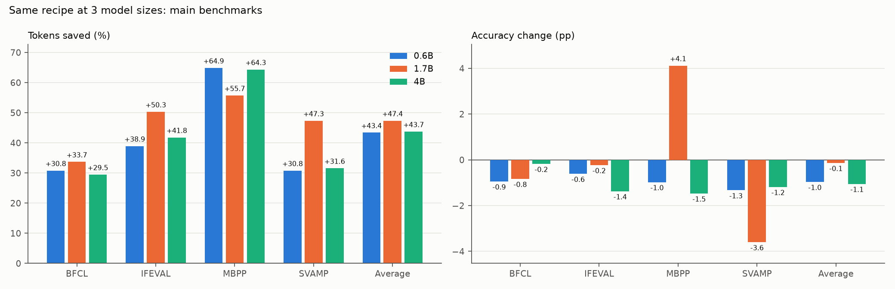

# Does Learning to Stop Scale?

In [Where the Thinking Stops Mattering](https://github.com/Herz1c/WhereTheThinkingStopsMattering) I taught
Qwen3-0.6B to stop reasoning once its own thinking stops mattering. The result was 43% fewer generated tokens at
about −1 pp accuracy, with the change being in the weights only. This repository investigates whether
does the same recipe work on a larger model, without re-tuning it? The first step is Qwen3-1.7B, the second
Qwen3-4B.

**Answer for 1.7B is yes, and it is even slightly better.** Over the same four benchmarks, the 1.7B model trained with
the same recipe generates **47.4% fewer tokens at −0.14 pp average accuracy** (mean of two full evaluations),
against 43.4% / −0.97 pp at 0.6B. On HumanEval, which played no part in any decision, it saves 58% at
−0.8 pp.

**Answer for 4B is yes as well.** Same recipe, same criterion: **43.7% fewer tokens at −1.05 pp average accuracy**
(mean of two full evaluations), close to the 0.6B result benchmark by benchmark. On HumanEval it saves 62% at
+2.1 pp. The accuracy loss is small but real: its interval excludes zero in both runs.

| Model | Tokens saved | Accuracy change | HumanEval (held-out) |
| --- | ---: | ---: | ---: |
| Qwen3-0.6B | 43.4% | −0.97 pp | 65.0% / −1.22 pp |
| Qwen3-1.7B | 47.4% | −0.14 pp | 58.4% / −0.76 pp |
| Qwen3-4B | 43.7% | −1.05 pp | 61.7% / +2.13 pp |

Three sizes, one training run each, are not enough to claim a trend with size; what they show is that the recipe
keeps working without re-tuning.

Student project, October–November 2026. 1.7B: one RTX 5060 Ti (16 GB), about 70 GPU-hours. 4B: an RTX PRO 6000
(96 GB) provided and run by [mrtineu](https://github.com/mrtineu), about 20 GPU-hours.

<p align="center"></p>

## Result: Qwen3-1.7B

| Benchmark | What it tests | Tokens saved, 1.7B | Accuracy change, 1.7B | 0.6B (two-run mean) |
| --- | --- | ---: | ---: | ---: |
| MBPP+ | writing a Python function | **55.7%** | **+4.12 pp** | 64.9% / −0.98 pp |
| IFEval | following format instructions | **50.3%** | −0.23 pp | 38.9% / −0.61 pp |
| BFCL (3 subsets) | function calling | **33.7%** | −0.84 pp | 30.8% / −0.94 pp |
| SVAMP | grade-school arithmetic | **47.4%** | −3.60 pp | 30.8% / −1.33 pp |
| **Average** | | **47.4%** | **−0.14 pp** | 43.4% / −0.97 pp |

Mean of two full evaluations of the same adapter, 8 samples per question, 22,072 responses each:
+47.3% [45.9, 48.7] / −0.21 pp [−0.95, +0.59] and +47.4% [46.0, 48.7] / −0.07 pp [−0.83, +0.74]
(95% paired bootstrap intervals over questions). Tokens saved per benchmark is one minus the ratio of
summed tokens, thinking included, a response cut off at the cap counted in full and as wrong; the
average is the geometric mean over benchmarks, accuracy change the arithmetic mean. vLLM is not
bit-reproducible: only 34% of responses are identical between the two runs. The 0.6B column is the mean of
its two full runs as well; the per-benchmark table in the 0.6B repository shows one of the two, so those
numbers differ slightly from these.

**Held-out sets** (never looked at during development):

| Set | Tokens saved | Accuracy change |
| --- | ---: | ---: |
| HumanEval (164 × 4) | **58.4%** [54.5, 62.2] | −0.76 pp [−4.57, +3.05] |
| GSM8K test (500 × 2) | 35.9% [32.5, 39.1] | +34.1 pp (mostly the requested answer format, learned) |
| MATH-500, all levels (313 × 4) | 11.4% [9.6, 13.5] | +4.8 pp [+2.7, +7.0] (graded format-independently) |

**Criterion fixed in advance** for "the method transfers": at least 30% saved and at least −1.5 pp average
accuracy on the two-run mean, and a HumanEval interval that covers zero. All three are met. (Written in my
research log before the 1.7B runs. The log is private, so this is self-reported; see
[PREREGISTRATION.md](PREREGISTRATION.md), where later criteria are committed before their results.)

### What did not go well

- **SVAMP loses 3.6 pp, and about 90% of it is answer format, not arithmetic.** The trained model more often
  writes the computation into the answer line ("Final answer: 5 + 3 = 8") or closes its reasoning twice;
  SVAMP's grader rightly rejects both. Wrong values rose only from 388 to 414 of 8,000. The habit appears
  after the supervised stage and the RL stage amplifies it while shortening SVAMP from 24% to 47% saving.
- **BFCL irrelevance loses 4.7 pp:** the model calls a function more often where it should decline.
- Both were fixed before the 4B run (below).

## Result: Qwen3-4B

| Benchmark | Tokens saved, 4B | Accuracy change, 4B | 1.7B | 0.6B |
| --- | ---: | ---: | ---: | ---: |
| MBPP+ | **64.3%** | −1.47 pp | 55.7% / +4.12 pp | 64.9% / −0.98 pp |
| IFEval | **41.8%** | −1.37 pp | 50.3% / −0.23 pp | 38.9% / −0.61 pp |
| BFCL (3 subsets) | **29.5%** | −0.18 pp | 33.7% / −0.84 pp | 30.8% / −0.94 pp |
| SVAMP | **31.6%** | −1.19 pp | 47.4% / −3.60 pp | 30.8% / −1.33 pp |
| **Average** | **43.7%** | **−1.05 pp** | 47.4% / −0.14 pp | 43.4% / −0.97 pp |

Two full evaluations of the same adapter: +43.9% [42.5, 45.3] / −1.14 pp [−1.68, −0.57] and
+43.6% [42.1, 45.0] / −0.97 pp [−1.46, −0.44]; 32% of responses are identical between the two runs. The
supervised stage alone gives 31.1% / −0.78 pp; the RL stage adds the rest, mostly on SVAMP (8% → 32%) and MBPP.
The model still reasons on every question: no response in any run has fewer than ten thinking tokens.

| Held-out set | Tokens saved | Accuracy change |
| --- | ---: | ---: |
| HumanEval (164 × 4) | **61.7%** [58.6, 64.9] | +2.13 pp [−1.37, +5.95] |
| GSM8K test (500 × 2) | 32.4% [30.0, 34.9] | +6.6 pp [+4.7, +8.7] (graded format-independently) |
| MATH-500, all levels (313 × 4) | 11.5% [10.0, 13.2] | +10.4 pp [+8.0, +12.9] (graded format-independently) |

The **criterion fixed in advance** (the same as for 1.7B, written down in the research log before any 4B
training result; self-reported, as above) is met:
43.7% ≥ 30%, −1.05 pp ≥ −1.5 pp, and the HumanEval interval covers zero. HumanEval is a weak test at this
size, though: the 4B base already solves 89.5% of it. GSM8K and MATH share their source with the training pools.

### What changed for 4B

- **The two 1.7B negatives were addressed first.** Math answers now count as correct in training only if the
  last line is "Final answer: N" with a bare number, and every supervised math example closes that way. On SVAMP
  the "number alone" errors stay at the base model's level (22 → 19 of 8,000; at 1.7B they went 18 → 200). The
  function-calling pool now includes requests where the right function has been removed, and BFCL irrelevance
  loses 1.0 pp with an interval covering zero (1.7B: −4.7 pp).
- **Harder pools, by the same matching rule:** GSM8K with MATH levels 3–4, KodCode hard with some medium,
  function calling with more offered functions, instructions with four constraints instead of one or two. Share of
  correct base attempts: math 66% (target 71%), code 54% (52%), instructions 69% (67%). The function-calling
  pool stayed far too easy (89% against 64%) and gave the RL stage almost no signal.
- **Two bugs found by the calibration run and fixed:** the function-calling labels read only the first assistant
  turn, so some "no call" examples were mislabeled; and the checker for "end with a question / exclamation"
  failed on a trailing emoji. Both existed in the 0.6B and 1.7B data as well.
- The pool composition and both fixes were decided after seeing the 4B base on calibration questions, not
  before; the training recipe, its hyperparameters and the criterion were fixed before any 4B training result.
- Base and trained 4B model were generated on the same card, a different one from the smaller studies.

### What did not go well at 4B

- **SVAMP still loses 1.2 pp, now through wrong values** (238 → about 357 of 8,000), concentrated in the
  longest fifth of questions (−4.5 pp), partly offset by capped responses almost disappearing (75 → 11).
- **A new format defect:** about 35 SVAMP responses open the answer with a second `</think>` and are rejected
  although the number is usually right (≈ 0.4 pp). The reward gives such answers nothing, yet the RL stage did
  not remove them.
- **IFEval loses 1.4 pp** (interval excludes zero in one run of two), **MBPP 1.5 pp** (borderline), the latter on
  the questions the 0.6B base never solves.
- Only 16 give-up examples for math qualified under the stricter answer format, where up to 300 were allowed.

## Harder data for a stronger model

The 0.6B recipe trains on GSM8K and easy coding tasks. For 1.7B those are nearly solved: 80% of GSM8K
questions are answered right in all four tries, and 87% of finished attempts at the easy coding tasks pass
their tests. Yet on the benchmarks 1.7B spends 26% *more* tokens than 0.6B, mostly in a long tail of coding
answers that run out of budget. Training only on easy questions risks a model that learns "short is fine"
and then stops too early on hard ones.

So the training pools were **matched in difficulty to what 0.6B saw**, by a rule fixed before any 1.7B
training result: mix the easy pool with a harder one (MATH levels 3–5; KodCode medium and hard) in the
proportion that gives the 1.7B base the same share of correct attempts as 0.6B had on its original pool
(math 70.8%, code 51.9%). Calibration on 200 hard questions per domain gave 40% hard math and 80% hard code.

Did it work? On the questions the base model gets right at most half the time, the trained model is *more*
accurate on all four benchmarks (+5.6 to +9.3 pp), and on HumanEval's longest fifth +14.8 pp. (Those subsets
are picked from the base run's own samples, which flatters any second run a little; the 0.6B model under the
same selection gained nothing on code or function calling, so the gap between the sizes is not just the
selection.) On
MATH-500, all three model sizes save the least on the hardest levels and gain accuracy there:

<p align="center"></p>

The model does not cut its reasoning uniformly; it cuts where the extra reasoning was not paying off.

## The method, briefly

Both stages train a LoRA (r = 16) on the model's own outputs, never on evaluation data:

1. **Stop-point distillation.** Sample the base model's reasoning on training tasks, force `</think>` at
   paragraph boundaries, find the earliest cut where the forced answer is verifiably right (unit tests, the
   gold number, the right function call, a checked format constraint), and train on *own reasoning up to the
   cut + `</think>` + answer*. Three rules from the 0.6B work keep accuracy: on code, stop only after the
   function is drafted in the reasoning; after a long unproductive attempt, give up with a best guess; for
   instruction following, use verifiable constraints of types IFEval does not use.
2. **GRPO** from that adapter, reward `1[correct] · (1 − α · length / domain mean length)`; a wrong or capped
   answer earns nothing whatever its length.

The 0.6B repository explains the method and its failures in detail; nothing about it was re-tuned here.

## What changed from the 0.6B setup, and why

All written into the research log before the results they could affect (the log is private; see
[PREREGISTRATION.md](PREREGISTRATION.md) for what that does and does not prove):

- **Own evaluation module** (`evaluation/`) instead of the reference harness. Same protocol; the benchmark
  authors' graders (EvalPlus, BFCL's AST checker, Google's IFEval verifiers) are downloaded at pinned
  revisions and called directly. Checked against the reference on the 0.6B baseline: byte-identical question
  file, 22,070 of 22,072 stored responses graded the same (the two others hinge on a random draw inside an
  IFEval verifier), and a full re-run gave −0.3% tokens / −0.11 pp with every interval covering zero.
- **Difficulty-matched training pools** (above).
- **A fixed code grader.** 1.7B often follows its solution with a usage-example block; the training grader
  read the last block and called correct solutions wrong. It now reads the block that defines the function.
- **Hard MATH solutions in the supervised data** close with `\boxed{N}` rather than the requested
  "Final answer: N"; only that closing line is rewritten, the reasoning stays the model's own.
- **Difficulty-aware reporting:** MATH-500 by level, and accuracy by how often a fixed reference (the 0.6B
  base) solved each question, so the same bins can be laid over every model size.

Deviations that happened rather than were planned: the run was interrupted twice by Windows Update and once
by a pause; every step resumed from its saved state, except that GRPO continued from step 30 with a fresh
optimizer state. The hard coding pool came out easier than its calibration sample (56.8% correct attempts
against a 51.9% target). Details, timings and every number are kept in a private research log.

## Reproduce

Requirements: Python 3.12, a CUDA GPU with ≥ 16 GB, vLLM, Transformers 4.57, PEFT, bubblewrap for running
model-written code. Set `BASE_MODEL=Qwen/Qwen3-1.7B` for every training script. The 4B run (a card with far
more memory) is scripted end to end in `chains/`: `setup.sh`, `calibrate_4b.sh`, `generate_4b.sh`, `train_4b.sh`.

```bash
python -m evaluation.sources --bench bench                      # benchmarks + their graders, pinned
python -m evaluation.run --out runs/base --model Qwen/Qwen3-1.7B
python stopping/base_data.py                                     # GSM8K etc. -> data/train.jsonl
python stopping/code_tasks.py build                              # KodCode easy
python stopping/code_tasks.py build --difficulty medium,hard --prefix code_hard
python stopping/math_tasks.py                                    # MATH train, levels 3-5
python stopping/tool_tasks.py build                              # Glaive function calling
python analysis/overlap_check.py --train data/tool_train.jsonl --sources glaive     --questions bench/questions.jsonl --write-clean data/tool_train_clean.jsonl
python stopping/constraint_tasks.py --out data/constraint_train.jsonl --count 3000 --questions bench/questions.jsonl
python stopping/constraint_tasks.py --out data/wrapper_train.jsonl --count 2500 --wrappers --questions bench/questions.jsonl
```

Then, per domain: `generate_rollouts.py` → `mix_pools.py calibrate/merge` → `find_stop_points.py` →
`verified_examples.py --mode draft` → `give_up_examples.py` → `build_shortest.py` → `train_lora.py` →
`train_grpo.py --pool math=… --pool code=…` → `evaluation.run --adapter …` and `evaluation.compare`.
Each script's docstring gives its arguments; the values used are those of the 0.6B run, plus the
difficulty-matching steps above.

## Data and licences

Training data: GSM8K (MIT), MATH train split (MIT), KodCode-Light-RL-10K (CC BY-NC 4.0, used for
non-commercial research and not redistributed), Glaive function calling v2 (Apache-2.0),
databricks-dolly-15k (CC BY-SA 3.0) with own format constraints. Every training source was checked for
8-gram overlap with all evaluation questions. Benchmarks and their graders are downloaded from their authors
and not redistributed. Base models: Qwen3-1.7B and Qwen3-4B (Apache-2.0).

The evaluation protocol (prompts, sampling, token caps, metric) follows the
[ThinkingCap Test](https://github.com/BottleCapAI/ThinkingCap-Test) by BottleCapAI (Apache-2.0), where the
0.6B work started; this repository re-implements it and contains none of its code.

## Next

A much larger model, Qwen3.8-27B, and reasoning that is tens of thousands of tokens long rather than hundreds.
That work is in progress and not reported here yet. Its success criteria, method and selection rules are
committed in [PREREGISTRATION.md](PREREGISTRATION.md) before the results they judge; the results will be added
here when the runs are complete, the negative ones included.

Still open from the three sizes above: the doubled `</think>`, a function-calling pool that is actually hard
for the base model, held-out sets for function calling and instruction following, a harder held-out coding
set, and more than one training seed.
