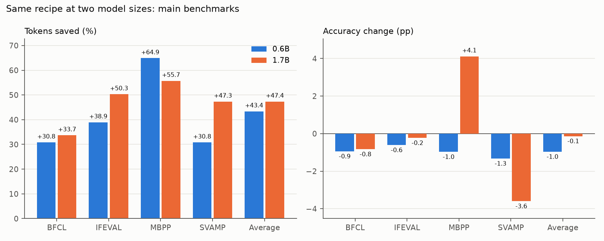
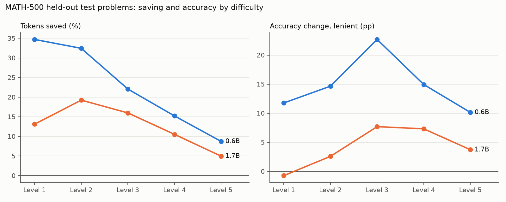

# Does Learning to Stop Scale?

In [Where the Thinking Stops Mattering](https://github.com/Herz1c/WhereTheThinkingStopsMattering) I taught
Qwen3-0.6B to stop reasoning once its own thinking stops mattering: about 43% fewer generated tokens at
about −1 pp accuracy, with the change in the weights only. This repository asks the obvious next question:
**does the same recipe work on a larger model, without re-tuning it?** The first step is Qwen3-1.7B.

**Answer for 1.7B: yes, and slightly better.** Over the same four benchmarks, the 1.7B model trained with
the same recipe generates **47.4% fewer tokens at −0.14 pp average accuracy** (mean of two full evaluations),
against 43.4% / −0.97 pp at 0.6B. On HumanEval, which played no part in any decision, it saves 58% at
−0.8 pp. The protocol, the success criterion and every change to the plan were written down before the
results they could affect.

Independent student project, October 2026, one RTX 5060 Ti (16 GB), about 70 GPU-hours for the 1.7B run.

<p align="center"></p>

## Result

| Benchmark | What it tests | Tokens saved, 1.7B | Accuracy change, 1.7B | 0.6B, for comparison |
| --- | --- | ---: | ---: | ---: |
| MBPP+ | writing a Python function | **55.7%** | **+4.12 pp** | 64.9% / −0.98 pp |
| IFEval | following format instructions | **50.3%** | −0.23 pp | 38.9% / −0.61 pp |
| BFCL (3 subsets) | function calling | **33.7%** | −0.84 pp | 30.8% / −0.94 pp |
| SVAMP | grade-school arithmetic | **47.4%** | −3.60 pp | 30.8% / −1.33 pp |
| **Average** | | **47.4%** | **−0.14 pp** | 43.4% / −0.97 pp |

Mean of two full evaluations of the same adapter, 8 samples per question, 22,072 responses each:
+47.3% [45.9, 48.7] / −0.21 pp [−0.95, +0.59] and +47.4% [46.0, 48.7] / −0.07 pp [−0.83, +0.74]
(95% paired bootstrap intervals over questions). Tokens saved per benchmark is one minus the ratio of
summed tokens, thinking included, a response cut off at the cap counted in full and as wrong; the
average is the geometric mean over benchmarks, accuracy change the arithmetic mean. vLLM is not
bit-reproducible: only 34% of responses are identical between the two runs.

**Held-out sets** (never looked at during development):

| Set | Tokens saved | Accuracy change |
| --- | ---: | ---: |
| HumanEval (164 × 4) | **58.4%** [54.5, 62.2] | −0.76 pp [−4.57, +3.05] |
| GSM8K test (500 × 2) | 35.9% [32.5, 39.1] | +34.1 pp (mostly the requested answer format, learned) |
| MATH-500, all levels (313 × 4) | 11.4% [9.6, 13.5] | +4.8 pp [+2.7, +7.0] (graded format-independently) |

**Pre-registered criterion** for "the method transfers": at least 30% saved and at least −1.5 pp average
accuracy on the two-run mean, and a HumanEval interval that covers zero. All three are met.

### What did not go well

- **SVAMP loses 3.6 pp, and about 90% of it is answer format, not arithmetic.** The trained model more often
  writes the computation into the answer line ("Final answer: 5 + 3 = 8") or closes its reasoning twice;
  SVAMP's grader rightly rejects both. Wrong values rose only from 388 to 414 of 8,000. The habit appears
  after the supervised stage and the RL stage amplifies it while shortening SVAMP from 24% to 47% saving.
- **BFCL irrelevance loses 4.7 pp:** the model calls a function more often where it should decline.
- Both are the first things to fix before a larger model (see [Next](#next)).

## Harder data for a stronger model

The 0.6B recipe trains on GSM8K and easy coding tasks. For 1.7B those are nearly solved: 80% of GSM8K
questions are answered right in all four tries, and 87% of finished attempts at the easy coding tasks pass
their tests. Yet on the benchmarks 1.7B spends 26% *more* tokens than 0.6B, mostly in a long tail of coding
answers that run out of budget. Training only on easy questions risks a model that learns "short is fine"
and then stops too early on hard ones.

So the training pools were **matched in difficulty to what 0.6B saw**, by a rule fixed before any 1.7B
training result: mix the easy pool with a harder one (MATH levels 3–5; KodCode medium and hard) in the
proportion that gives the 1.7B base the same share of correct attempts as 0.6B had on its original pool
(math 70.8%, code 51.9%). Calibration on 200 hard questions per domain gave 40% hard math and 80% hard code.

Did it work? On the questions the base model gets right at most half the time, the trained model is *more*
accurate on all four benchmarks (+5.6 to +9.3 pp), and on HumanEval's longest fifth +14.8 pp. (Those subsets
are picked from the base run's own samples, which flatters any second run a little; the 0.6B model under the
same selection gained nothing on code or function calling, so the gap between the sizes is not just the
selection.) On
MATH-500, both model sizes save the least on the hardest levels and gain accuracy there:

<p align="center"></p>

The model does not cut its reasoning uniformly; it cuts where the extra reasoning was not paying off.

## The method, briefly

Both stages train a LoRA (r = 16) on the model's own outputs, never on evaluation data:

1. **Stop-point distillation.** Sample the base model's reasoning on training tasks, force `</think>` at
   paragraph boundaries, find the earliest cut where the forced answer is verifiably right (unit tests, the
   gold number, the right function call, a checked format constraint), and train on *own reasoning up to the
   cut + `</think>` + answer*. Three rules from the 0.6B work keep accuracy: on code, stop only after the
   function is drafted in the reasoning; after a long unproductive attempt, give up with a best guess; for
   instruction following, use verifiable constraints of types IFEval does not use.
2. **GRPO** from that adapter, reward `1[correct] · (1 − α · length / domain mean length)`; a wrong or capped
   answer earns nothing whatever its length.

The 0.6B repository explains the method, its prior art and its failures in detail; nothing about it was
re-tuned here.

## What changed from the 0.6B setup, and why

All written into the research log before the results they could affect:

- **Own evaluation module** (`evaluation/`) instead of the reference harness. Same protocol; the benchmark
  authors' graders (EvalPlus, BFCL's AST checker, Google's IFEval verifiers) are downloaded at pinned
  revisions and called directly. Checked against the reference on the 0.6B baseline: byte-identical question
  file, 22,070 of 22,072 stored responses graded the same (the two others hinge on a random draw inside an
  IFEval verifier), and a full re-run gave −0.3% tokens / −0.11 pp with every interval covering zero.
- **Difficulty-matched training pools** (above).
- **A fixed code grader.** 1.7B often follows its solution with a usage-example block; the training grader
  read the last block and called correct solutions wrong. It now reads the block that defines the function.
- **Hard MATH solutions in the supervised data** close with `\boxed{N}` rather than the requested
  "Final answer: N"; only that closing line is rewritten, the reasoning stays the model's own.
- **Difficulty-aware reporting:** MATH-500 by level, and accuracy by how often a fixed reference (the 0.6B
  base) solved each question, so the same bins can be laid over every model size.

Deviations that happened rather than were planned: the run was interrupted twice by Windows Update and once
by a pause; every step resumed from its saved state, except that GRPO continued from step 30 with a fresh
optimizer state. The hard coding pool came out easier than its calibration sample (56.8% correct attempts
against a 51.9% target). Details, timings and every number are kept in a research log (not public yet).

## Reproduce

Requirements: Python 3.12, a CUDA GPU with ≥ 16 GB, vLLM, Transformers 4.57, PEFT, bubblewrap for running
model-written code. Set `BASE_MODEL=Qwen/Qwen3-1.7B` for every training script.

```bash
python -m evaluation.sources --bench bench                      # benchmarks + their graders, pinned
python -m evaluation.run --out runs/base --model Qwen/Qwen3-1.7B
python stopping/base_data.py                                     # GSM8K etc. -> data/train.jsonl
python stopping/code_tasks.py build                              # KodCode easy
python stopping/code_tasks.py build --difficulty medium,hard --prefix code_hard
python stopping/math_tasks.py                                    # MATH train, levels 3-5
python stopping/tool_tasks.py build                              # Glaive function calling
python analysis/overlap_check.py --train data/tool_train.jsonl --sources glaive     --questions bench/questions.jsonl --write-clean data/tool_train_clean.jsonl
python stopping/constraint_tasks.py --out data/constraint_train.jsonl --count 3000 --questions bench/questions.jsonl
python stopping/constraint_tasks.py --out data/wrapper_train.jsonl --count 2500 --wrappers --questions bench/questions.jsonl
```

Then, per domain: `generate_rollouts.py` → `mix_pools.py calibrate/merge` → `find_stop_points.py` →
`verified_examples.py --mode draft` → `give_up_examples.py` → `build_shortest.py` → `train_lora.py` →
`train_grpo.py --pool math=… --pool code=…` → `evaluation.run --adapter …` and `evaluation.compare`.
Each script's docstring gives its arguments; the values used are those of the 0.6B run, plus the
difficulty-matching steps above.

## Data and licences

Training data: GSM8K (MIT), MATH train split (MIT), KodCode-Light-RL-10K (CC BY-NC 4.0, used for
non-commercial research and not redistributed), Glaive function calling v2 (Apache-2.0),
databricks-dolly-15k (CC BY-SA 3.0) with own format constraints. Every training source was checked for
8-gram overlap with all evaluation questions. Benchmarks and their graders are downloaded from their authors
and not redistributed. Base model: Qwen3-1.7B (Apache-2.0).

The evaluation protocol (prompts, sampling, token caps, metric) follows the
[ThinkingCap Test](https://github.com/BottleCapAI/ThinkingCap-Test) by BottleCapAI (Apache-2.0), where the
0.6B work started; this repository re-implements it and contains none of its code.

## Next

Qwen3-4B, then a much larger model. Before that, two fixes for the negatives above: normalise the closing
answer line of every math training example, not only the hard ones, and score the "number alone" answer
format in the math reward; and add function-calling examples where the right answer is to decline.
